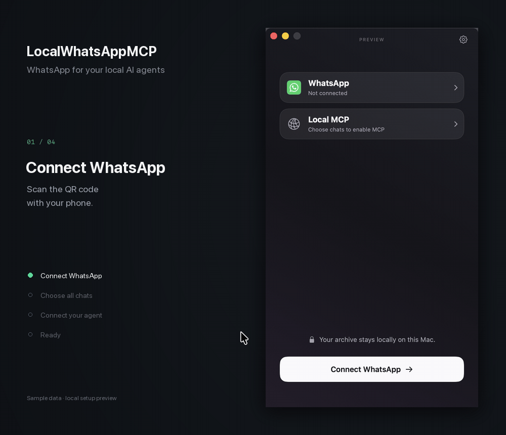

# LocalWhatsAppMCP

A native macOS menu bar app that connects WhatsApp to AI agents running on your Mac through **MCP**. Choose which chats they can read and whether they can send messages. Your archive stays on your Mac.

Download it [here](https://github.com/massimokris/local_whatsapp_mcp/releases/download/v1/LocalWhatsAppMCP-1.0.0-arm64.dmg) for free.



*Setup preview with sample data; WhatsApp linking and agent setup are simulated.*

## Install

Requires **macOS 13 or later**. The current build is verified on Apple silicon and uses ad-hoc signing by default.

1. Download and open [LocalWhatsAppMCP-1.0.0-arm64.dmg](https://github.com/massimokris/local_whatsapp_mcp/releases/download/v1/LocalWhatsAppMCP-1.0.0-arm64.dmg).
2. Drag **LocalWhatsAppMCP** into the **Applications** folder.
3. Eject the disk image and open **LocalWhatsAppMCP** from Applications.

Click the menu bar icon to open the panel. Quit an existing copy before replacing it; your saved data is retained. To build the DMG, use the commands under [Contributing](#contributing).

## Connect

1. **Connect WhatsApp** — scan the QR code from WhatsApp’s **Linked Devices** screen on your phone.
2. **Choose chats** — choose which chats to sync and make available to agents, or continue with all chats.
3. **Connect your agent** — click **Copy instructions**, paste them into your agent’s chat and send. Your agent saves its credential, configures its MCP connection and checks that it works.

Each screen opens automatically after the previous step. The pairing code expires after ten minutes. **Do it manually** lets you copy the MCP URL and access token into your client’s settings instead.

Open **Local MCP** to add connections, view credentials or remove an agent’s access. Use **Choose** on the WhatsApp card to change the shared chat scope.

## Permissions and local access

**Message sending** starts off for each connection. Expand its card under **Local MCP** and enable **Allow message sending** when you want that agent to send messages.

**Start at Log In** is optional and available in settings. macOS may ask you to approve it.

The MCP server starts automatically and accepts connections only from this Mac. Sync and agent access continue when you close the panel; **Quit** stops them. The Mac must be awake and the app running. WhatsApp determines how much history is available, and attachments download on demand.

## Architecture

**Native menu bar app** built with SwiftUI and AppKit. A bundled Go service handles local MCP connections and enforces chat scope and agent permissions. A pinned, patched wacli owns the WhatsApp connection and SQLite/FTS5 archive. Your agent handles reasoning, schedules and notifications.

Messages, linked-device state, configuration, credentials and cached media live in `~/Library/Application Support/LocalWhatsAppMCP/`. App-managed credentials use a private local SQLite database. Demo data stays separate from real accounts.

See [CONTEXT.md](CONTEXT.md) for domain terms, [component interfaces](docs/implementation/interfaces.md) for integration contracts and the [decision map](docs/wayfinder/map.md) for accepted decisions.

## Project structure

```text
native/
  Sources/LocalWhatsAppMCP/   # Menu bar app, shared state and SwiftUI views
  Sources/LocalWhatsAppCore/  # State models, chat selection and helper runtime
  Tests/                     # Native flow and core tests
backend/                     # Go MCP service, access policy and engine adapter
vendor/wacli/                # Pinned engine, integration patch and build scripts
packaging/                   # Bundle metadata, app icon and third-party notices
scripts/                     # Build, test, package and verify the app
docs/                        # Decisions, research and implementation records
CONTEXT.md                   # Domain terms
AGENTS.md                    # Shared instructions for coding agents
CLAUDE.md                    # Claude Code entry point
```

## Contributing

PRs welcome. If you use Codex or Claude Code, start with [AGENTS.md](AGENTS.md) and describe what you want to build.

Use macOS with Xcode or the Command Line Tools, Swift 5.9 or later, Go 1.27.3 and Git. From the project root, run:

```sh
./scripts/test.sh
./scripts/package.sh
python3 ./scripts/smoke-bundle.py dist/LocalWhatsAppMCP.app
```

`test.sh` runs native tests, Go race tests and vet, engine suites and packaging checks. `package.sh` creates the app, DMG, ZIP and checksums under `dist/`. `./scripts/build.sh` builds only the app. See the [packaging script](scripts/package.sh) for signing and notarization options.

The bundle smoke test uses synthetic data without a WhatsApp login. Live WhatsApp linking, client setup and sleep/wake behavior need separate installation checks.
